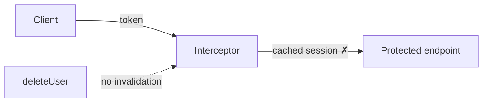

# Session report

The only output every phase produces.
Audience: the user, reading a terminal right now.
Return it as plain GitHub-Flavored Markdown in the session, never inside a code fence, never as a file on disk.

## Voice

Terse. Essentials only.
Fragments over sentences. Drop articles, filler, hedging, preamble, and recap.
Compress prose; keep paths, symbols, commands, quoted errors, and identifiers exact.
State findings and results only: preconditions, boundaries, and phase procedure are shared context, never repeated back.

## Icons

Plain Unicode only, fixed meanings, at most one per line:

| Icon | Meaning                                 |
| ---- | --------------------------------------- |
| `✓`  | holds, passes, verified                 |
| `✗`  | violated, fails, proven defect          |
| `⚠`  | limitation, assumption, unresolved risk |
| `→`  | flow, causality, transition             |

No emoji, no Nerd Font glyphs, no decorative icons.
Icons describe the assessed system, never the report's own progress: mark a violated invariant with `✗`, never a step you did not perform.

## Skeleton

```markdown
# <Phase>: <target>

**Status:** complete | partial | blocked
**Revision:** <repository> · <ref> · <commit>

## Coverage and limitations

- Examined: <surfaces and boundaries>
- ⚠ Partial: <surface and reason>
- ⚠ Skipped: <surface and reason>

<phase body>
```

`<ref>` and `<commit>` always name the assessed revision recorded during preflight, never a branch a phase created.
Name behavior surfaces and boundaries, not file counts; never use coverage percentages.

Status is:

- `complete`: the requested work finished at the declared depth;
- `partial`: useful work finished, but named surfaces or evidence remained unavailable;
- `blocked`: repository state or missing context prevented meaningful work.

`complete` means the bounded phase finished, never that the product is secure.

## Next phase

When a useful next phase exists, end with one short proposal and wait for explicit approval:

- after scan, when at least one candidate needs `full` or `focused` regression:
  `**Next:** Regression testing creates isolated test branches to prove, reject, or refresh the candidates. Start it?`
- after regression testing, when at least one candidate is `proven`:
  `**Next:** Private disclosure pushes the proven branches privately, then creates or updates Jira. Start it?`

Never start the next phase implicitly.
Omit the proposal when no useful next phase exists or after private disclosure.

## Diagrams

Add at most one Mermaid diagram per report, and only when a flow explains the defect faster than prose.
Keep it under ten nodes, label the violated step, and never diagram architecture the finding does not touch.

````markdown

````

Mermaid belongs to the session report only.
Jira renders it as text; ship an SVG there instead.

## Phase bodies

- Scan: candidate cards, or the explicit no-candidate result.
- Regression testing: one verdict block per candidate with test, control, commands, branch.
- Private disclosure: ticket key, URL, status, pushed branch, attachment names, deduplication outcome.

Separate findings with a `---` rule: one before each candidate card or verdict block, none after the last.
A single finding still gets its opening rule, so the body always reads the same way.
